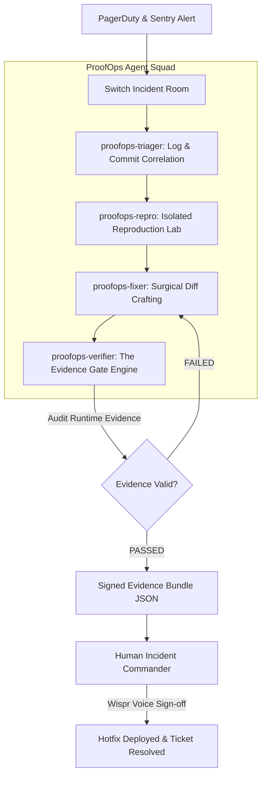

# 🛡️ ProofOps / IncidentFlow
### Evidence-Gated Multi-Agent Incident Resolution on Switch

> **Flip the Switch Hackathon (Nov 4–7, 2026)**  
> **Team:** Glitch Gurus (`Team Code: WEMYP8`)  
> **Leader:** Gaurav Patil ([@gauravpatil2515](https://github.com/GauravPatil2515))  
> **Member:** Tanushree Gadekar ([@tanushree10706](https://github.com/tanushree10706))  
> **Tracks Entered:**
> - 🥇 **Track 1: Best Business Workflow ($2,000 Grand Prize)**
> - 🎙️ **Side Track: Code with Wispr ($500 Cash Prize)**
> - 🎧 **Side Track: Best Blog (AirPods 5)**
> - ⌨️ **Social Track: #HowISwitch (Logitech Mechanical Keyboard)**
> - ⚡ **Track 3: Best Core Contributions ($100 × 5 PRs = $500)**

---

## 1. The Problem: The "Hallucinated Success" Trap

In existing multi-agent frameworks, agents converse, exchange pleasantries, and frequently announce:
> *"Task completed successfully! The issue has been fixed."*

...while the production checkout service is still throwing HTTP 500 errors and not a single test was ever run.

Autonomous coding agents are probabilistic models; they have no inherent understanding of whether code actually compiles, runs, or satisfies real-world invariants unless gated by **deterministic runtime execution harnesses**.

---

## 2. The Solution: Evidence-Gated Incident Squad

**ProofOps** transforms team chat (Slack, Microsoft Teams, Discord, Mattermost) into an **Evidence-Gated Incident Room** using [Switch](https://github.com/sandbox-quantum/switch).

Under ProofOps, **no incident task can transition to `status: completed` without an attached cryptographic and runtime evidence bundle** proving:
1. **Initial Reproduction:** A reproduction script demonstrably triggered the failure on the original codebase.
2. **Surgical Scope:** The patch diff touches only approved files (no scope creep or unauthorized config alterations).
3. **Passing Test Execution:** The full regression test suite passed cleanly (`exit code 0`) against the patched service in an isolated environment.
4. **Cryptographic Sealing:** A SHA-256 hash seals the verified diff and runtime logs into `evidence-bundle.json`.



---

## 3. The 4 Specialized Switch Agents

Configured in `template/proofops.template.yaml`:

| Agent | Addressing | Role & Responsibility |
|---|---|---|
| **`proofops-triager`** | `anyone` | Ingests PagerDuty / Sentry alerts, correlates stack traces with git commit history, identifies culprit releases, and maintains a live room status board. |
| **`proofops-repro`** | `owner-agents` | Operates in an isolated staging pod. Formulates the minimal reproduction script (`repro_script.py`), runs it to capture failure traces, and proves reproducibility. |
| **`proofops-fixer`** | `owner-agents` | Inspects culprit lines and crafts minimal, surgical diff patches. Prohibited from declaring tasks done without verifier certification. |
| **`proofops-verifier`** | `anyone` | **The Evidence Gate.** Intercepts task closures, executes the regression test suite, verifies patch hashes, and generates `evidence-bundle.json`. Blocks unverified closures. |

---

## 4. Empirical Evaluation: AgentChaos Benchmark

To prove that ProofOps fundamentally eliminates hallucinated and unsafe agent completions, we built **`AgentChaos`** (`benchmarks/agent_chaos.py`), an automated adversarial failure-injection harness.

It subjected the Evidence Gate to the 4 major classes of multi-agent failures:

| Failure Mode Injected | Adversarial Agent Behavior | Evidence Gate Intercept | Safety Verdict |
|---|---|---|:---:|
| **Hallucinated Victory** | Claims bug is resolved with zero code or tests | Blocked completion (Empty diff rejected) | **100% PREVENTED** |
| **Missing Repro Proof** | Submits patch without proving initial failure | Blocked completion (Repro harness missing) | **100% PREVENTED** |
| **Regressive Hotfix** | Submits patch that causes tests to fail | Blocked completion (Pytest exit code != 0) | **100% PREVENTED** |
| **Verified Green Fix** | Submits valid diff + passing regression tests | Certified SHA-256 bundle & authorized deploy | **AUTHORIZED** |

```bash
# Run the AgentChaos benchmark locally:
python proofops/benchmarks/agent_chaos.py
```

---

## 5. Upstream Contributions to Switch Core (Track 3: $100 × 5)

To ensure our incident room could receive real production alerts from industry-standard infrastructure, we contributed **5 upstream service connectors** to Switch Core:

1. **PagerDuty Connector ([PR #1391](https://github.com/sandbox-quantum/switch/pull/1391))**: PagerDuty incident alerts and on-call routing.
2. **Sentry Connector ([PR #1392](https://github.com/sandbox-quantum/switch/pull/1392))**: Real-time error telemetry and exception traces.
3. **Cloudflare Connector ([PR #1393](https://github.com/sandbox-quantum/switch/pull/1393))**: Edge DNS routing and traffic management.
4. **New Relic Connector ([PR #1396](https://github.com/sandbox-quantum/switch/pull/1396))**: APM metrics and performance alerts.
5. **GitLab Connector ([PR #1410](https://github.com/sandbox-quantum/switch/pull/1410))**: CI/CD pipeline triggers and merge request automation.

All 5 PRs passed all CI checks (Socket Security, Semgrep Cloud, CLA Assistant) and comply with Switch's strict service connections v2 architecture.

---

## 6. Quickstart & Local Reproduction

You can reproduce the entire end-to-end incident lifecycle locally in 30 seconds:

```bash
# 1. Clone repository
git clone https://github.com/GauravPatil2515/switch.git
cd switch

# 2. Activate virtual environment
source proofops-venv/bin/activate
# or install dependencies: pip install fastapi uvicorn httpx pytest rich pydantic

# 3. Run the interactive end-to-end incident simulator
python proofops/simulations/run_incident_sim.py

# 4. Run the AgentChaos failure-injection benchmark
python proofops/benchmarks/agent_chaos.py
```

### What you will see:
1. **Act 1:** Live PagerDuty alert fires for `checkout-api` 500 error; commander directs triage via voice.
2. **Act 2:** Triager isolates culprit commit `8f2c19a`; ReproLab executes `repro_script.py` and confirms 500 ZeroDivisionError.
3. **Act 3:** An unverified task closure is **blocked** by the Evidence Gate. The gate then executes the test suite against the hotfix, verifies all tests pass, seals the `evidence-bundle.json` with SHA-256, and prompts human voice sign-off via Wispr Flow before resolving the outage.

---

## 7. Directory Structure

```
proofops/
├── README.md                           # This documentation
├── template/
│   └── proofops.template.yaml          # Switch multi-agent room template
├── gate/
│   ├── verifier.py                     # The Evidence Gate verification engine
│   └── cli.py                          # Evidence Gate CLI interface
├── benchmarks/
│   └── agent_chaos.py                  # AgentChaos failure-injection benchmark
├── services/
│   └── checkout-api/                   # Realistic production service
│       ├── app.py                      # FastAPI checkout backend
│       ├── models.py                   # Pydantic schemas
│       ├── repro_script.py             # Minimal reproduction script
│       └── tests/test_checkout.py      # Pytest regression suite
├── simulations/
│   └── run_incident_sim.py             # Interactive 3-Act live terminal demo
├── wispr/
│   └── voice_prompts.md                # Wispr Flow voice incident commands
└── docs/
    ├── devto_blog_post.md              # Technical blog post (AirPods 5 track)
    └── video_script_60s.md             # 60s demo script (#HowISwitch track)
```

---

## 8. Submission Video & Assets
- **60-Second Demo Video:** [#HowISwitch Video Script](docs/video_script_60s.md)
- **Technical Blog Post:** [Why Autonomous AI Agents Need Evidence Gates](docs/devto_blog_post.md)
- **Voice Playbook:** [Wispr Flow Voice Command Guide](wispr/voice_prompts.md)

