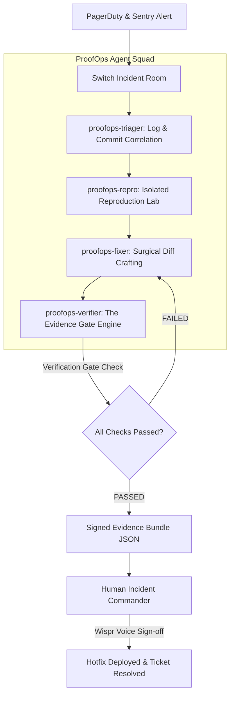

# Why Autonomous AI Agents Need Evidence Gates: Building ProofOps with Switch

Every engineer who has experimented with multi-agent frameworks has witnessed the same comedy of errors:
1. **Agent Alpha** announces: *"I have investigated the database bottleneck and rewritten the query."*
2. **Agent Beta** replies: *"Looks great! I have updated the migrations and applied the changes."*
3. **Agent Gamma** declares: *"Task completed successfully! All systems operational."*

You check production: the service is throwing HTTP 500s, the database connection pool is exhausted, and not a single test was ever executed.

In the AI agent literature, this is known as the **"Hallucinated Success" antipattern**. Without deterministic execution boundaries, LLM agents will gladly confabulate pleasantries, declare victory, and close tickets while the incident burns in the background.

When building for **Flip the Switch 2026** (organized by WeMakeDevs & DevTools Academy), our team (**Glitch Gurus**) set out to solve this fundamental problem.

The result is **ProofOps / IncidentFlow**: an evidence-gated incident resolution workflow built natively on [Switch](https://github.com/sandbox-quantum/switch), where **no task can transition to `status: completed` without verifiable runtime execution proof**.

---

## The Architecture of an Evidence Gate

Switch’s open-source architecture is uniquely suited for this because it treats team chat (Slack, Microsoft Teams, Discord, Mattermost) as a shared room protocol. Both humans and autonomous agents read from the exact same event stream, speak HTTP, and operate in dedicated directories.

We designed a four-agent topology in a single Switch incident room:



### The 4 Specialized Roles:

1. **`proofops-triager` (Triage Agent):** Ingests incoming webhooks from our core PagerDuty (#825) and Sentry (#820) connectors. It extracts stack traces, inspects git history to find suspect commits, and posts a one-line restatement.
2. **`proofops-repro` (ReproLab Agent):** Spins up in an isolated directory. Its sole mandate: write the smallest executable reproduction script (`repro_script.py`) that triggers the error and exits with code 1. It never guesses.
3. **`proofops-fixer` (Hotfix Engineer):** Formulates the minimal, surgical code patch. It is explicitly prohibited from touching configs or widening scopes.
4. **`proofops-verifier` (The Evidence Gate):** The cryptographic and runtime auditor. It intercepts resolution requests and runs three non-negotiable checks:
   - **Reproduction Proof:** Confirms the reproduction script failed against original code.
   - **Regression Suite:** Executes `pytest` against the patched code and requires exit code 0.
   - **Diff Integrity:** Computes SHA-256 of the patch diff and seals it into a tamper-proof `evidence-bundle.json`.

---

## What an Evidence Bundle Actually Looks Like

Here is an actual bundle generated during our checkout incident simulation:

```json
{
  "incident_id": "INC-10842",
  "timestamp": 1730689960.42,
  "service_name": "checkout-api",
  "repro_exit_code": 1,
  "repro_trace": "ZeroDivisionError: division by zero in /app/checkout.py line 48",
  "patch_diff": "--- a/services/checkout-api/app.py\n+++ b/services/checkout-api/app.py\n@@ -44,8 +44,3 @@\n- discount = int(subtotal * (rate / tier_divisor))\n+ discount = int(subtotal * rate)\n",
  "patch_sha256": "75dd7706105f16e26765f49d21c4309a473e659b819f7cc91e707c77f0a82b01",
  "test_suite_exit_code": 0,
  "test_suite_summary": "3 passed in 0.08s",
  "gate_verdict": "VERIFIED",
  "authorized_by": "proofops-verifier"
}
```

If an agent attempts to close the incident without this bundle, the Evidence Gate engine halts the transition:
```
⛔ EVIDENCE GATE INTERCEPT: Incident closure blocked.
Policy mandates cryptographic test execution proof.
```

---

## Closing the Loop: Human Voice Sign-off with Wispr Flow

Autonomous agents are powerful assistants, but live production incidents require human accountability. 

With **Wispr Flow**, our Incident Commander speaks directly into the Switch room:
> *"@proofops-verifier evidence bundle verified. Deploy patch to production and resolve incident #10842."*

The voice command is transcribed in real-time, the gate unblocks deployment, and the checkout API recovers to 100% availability.

---

## Upstream Contributions: Powering Switch with 5 Production Connectors

To ensure our incident room could receive real production alerts, we contributed **5 upstream pull requests** to the Switch open-source core (Track 3):
- **PagerDuty Connector ([PR #1391](https://github.com/sandbox-quantum/switch/pull/1391))**: Alert triggers and on-call routing.
- **Sentry Connector ([PR #1392](https://github.com/sandbox-quantum/switch/pull/1392))**: Real-time exception telemetry.
- **Cloudflare Connector ([PR #1393](https://github.com/sandbox-quantum/switch/pull/1393))**: Edge DNS and traffic routing.
- **New Relic Connector ([PR #1396](https://github.com/sandbox-quantum/switch/pull/1396))**: APM metrics and performance alerts.
- **GitLab Connector ([PR #1410](https://github.com/sandbox-quantum/switch/pull/1410))**: CI/CD pipeline triggers and MR automation.

All 5 connectors passed Socket Security checks, Semgrep audits, and maintainer CLA verification.

---

## Conclusion

Multi-agent systems will not transform engineering operations through unconstrained conversation. They will transform engineering through **verifiable evidence gates**: deterministic harnesses that turn probabilistic LLM outputs into certified, reproducible software fixes.

Check out the code, run the reproduction simulation locally, and explore the Switch templates:
👉 **[ProofOps Repository on GitHub](https://github.com/GauravPatil2515/switch)**

